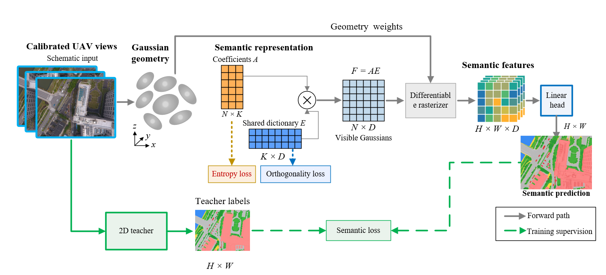

<div align="center">
<h1>E-Splat </h1>
<h3>E-Splat: Efficient UAV Semantic Scene Representation via Endmember-Based Algebraic Decoupling of 3D Gaussian Splatting</h3>
</div>


Based on the **[3D Gaussian Splatting](https://github.com/graphdeco-inria/gaussian-splatting)** framework, this project modifies its semantic representation and related training and rendering components to facilitate **compact semantic scene understanding in large-scale UAV scenes**.

## **Overview**

<p align="center">
  
</p>


## **Main Results**

**`Dataset: UrbanScene3D`**

E-Splat represents the semantic field with a shared global dictionary and compact per-Gaussian coefficient logits. The final benchmark results and ablation studies are reported in the accompanying paper.


## **Getting Started**

### Installation

ref : [3D Gaussian Splatting installation](https://github.com/graphdeco-inria/gaussian-splatting)

**Step 1: Clone the E-Splat repository:**

To get started, first clone the E-Splat repository and navigate to the project directory:

```bash
git clone https://github.com/CongLi-18/E-Splat.git
cd E-Splat
```

**Step 2: Environment Setup:**

E-Splat recommends setting up a conda environment and installing dependencies via pip. Use the following commands to set up the environment:

***Create and activate a new conda environment***

```bash
conda create -n E-Splat python=3.10
conda activate E-Splat
```

***Install Dependencies***

```bash
pip install -r requirements.txt
pip install submodules/simple-knn
pip install submodules/diff-gaussian-rasterization-esplat
```

The default rasterizer configuration uses 512 semantic channels for LSeg features. For 256-dimensional SAM features, change `NUM_SEMANTIC_CHANNELS` in `submodules/diff-gaussian-rasterization-esplat/cuda_rasterizer/config.h` to `256` and rebuild the rasterizer.

**Step 3: Prepare the Dataset:**

Prepare a COLMAP-compatible scene following the standard 3DGS layout:

```
data/<scene>/
  images/
  sparse/0/
    cameras.bin
    images.bin
    points3D.bin
```

Semantic teacher features should be stored with the scene. LSeg features use 512 channels by default, while SAM features use 256 channels.

**Step 4: Train E-Splat:**

For LSeg features:

```bash
python train.py \
  -s data/<scene> \
  -m output/esplat_<scene> \
  -f lseg \
  --iterations 30000 \
  --semantic_basis_count 16 \
  --esplat_feature_dim 512
```

For SAM features:

```bash
python train.py \
  -s data/<scene> \
  -m output/esplat_<scene> \
  -f sam \
  --iterations 30000 \
  --semantic_basis_count 16 \
  --esplat_feature_dim 256
```

**Step 5: Render the Results:**

```bash
python render.py \
  -s data/<scene> \
  -m output/esplat_<scene> \
  --iteration 30000
```

## :white_check_mark: Updates
* **`October 12, 2026`:** The project was reorganized and renamed as E-Splat. The README, semantic rasterizer path, and project-facing documentation were updated for the planned GitHub release.

## **Acknowledgment**

This project is based on [3D Gaussian Splatting](https://github.com/graphdeco-inria/gaussian-splatting) and uses open-source components including the differentiable Gaussian rasterizer, Simple-KNN, SIBR viewers, LSeg, and SAM. The original copyright notices and license files are retained in the repository and must remain with any redistributed copy.
